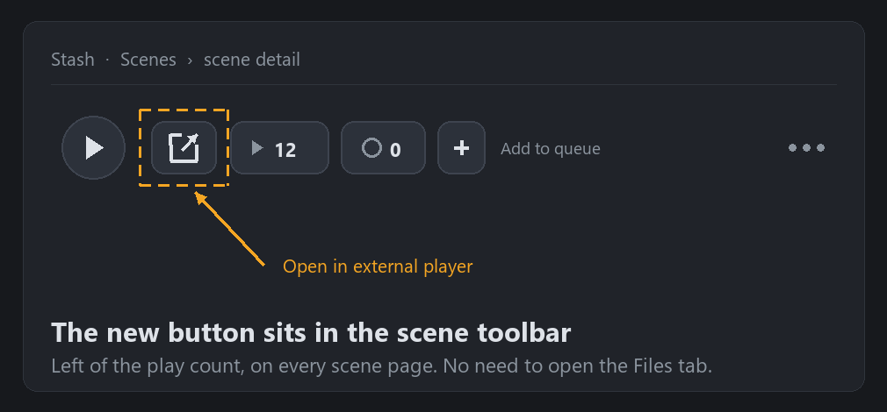

<p align="center" translate="no">
  <a href="README.md">English</a> ·
  <a href="README.zh-CN.md">简体中文</a> ·
  <a href="README.zh-TW.md">繁體中文</a> ·
  <a href="README.ja.md">日本語</a> ·
  <a href="README.ko.md">한국어</a> ·
  <a href="README.ru.md">Русский</a> ·
  <a href="README.de.md">Deutsch</a><br>
  <a href="README.es.md">Español</a> ·
  <a href="README.fr.md">Français</a> ·
  <a href="README.pt.md">Português</a> ·
  <a href="README.tr.md">Türkçe</a> ·
  <a href="README.vi.md">Tiếng Việt</a> ·
  <a href="README.th.md">ไทย</a> ·
  <b>Ελληνικά</b>
</p>

# Stash Open Media Player Remote

**Ένα κλικ και η σκηνή του Stash ανοίγει στον player που ήδη χρησιμοποιείτε — VLC, MPV, MPC-HC, SMPlayer, PotPlayer. Παίζει το αρχικό αρχείο και όχι ροή που μετακωδικοποιεί το πρόγραμμα περιήγησης, και δουλεύει ακόμη κι όταν το Stash τρέχει σε Docker πάνω σε NAS.**

## Τι κάνει αυτό το πρόσθετο

Κάθε σελίδα σκηνής αποκτά κουμπί **Άνοιγμα σε εξωτερικό player** στη γραμμή εργαλείων. Με ένα κλικ, η πραγματική διαδρομή αρχείου της σκηνής στέλνεται στον player του υπολογιστή σας.



*Η γραμμή εργαλείων της σκηνής: το νέο κουμπί βρίσκεται αμέσως αριστερά από τον μετρητή προβολών.*

- **Ένα κλικ, κουμπί πάντα εκεί** — βρίσκεται στη γραμμή εργαλείων της σκηνής, δίπλα στον μετρητή προβολών· δεν χρειάζεται να ανοίξετε την καρτέλα «Files».
- **Οποιοσδήποτε player** — ό,τι ξεκινά ως «εκτελέσιμο + διαδρομή αρχείου»: VLC, MPV, MPC-HC/BE, SMPlayer, PotPlayer κ.ά. Δίνετε μόνο την πλήρη διαδρομή του εκτελέσιμου.
- **Τοπική λειτουργία** — Stash και player στον ίδιο υπολογιστή: ο διακομιστής Stash ξεκινά τον player.
- **Απομακρυσμένη λειτουργία** — Stash σε Docker / Unraid / NAS / άλλον υπολογιστή: το πρόγραμμα περιήγησης δίνει σύνδεσμο `stashopenmediaplayerremote://` σε έναν μικρό βοηθό στον υπολογιστή σας, που ανοίγει τον player τοπικά. Ο διακομιστής δεν χρειάζεται πρόσβαση στην επιφάνεια εργασίας σας.
- **Αντιστοίχιση διαδρομών** — μετατροπή διαδρομών container σε πραγματικές, π.χ. `/data` → `//NAS/stash`.
- **Μορφή διαδρομής ανά player** — URL `file://` ή εγγενής διαδρομή· ανιχνεύεται αυτόματα (VLC και MPC συμπεριφέρονται διαφορετικά) ή επιβάλλεται με `keep` / `remove`.
- **Μετρητής προβολών (προαιρετικά)** — και το άνοιγμα σε εξωτερικό player μετράει ως προβολή.

### Γιατί εξωτερικός player

Ο ενσωματωμένος player του Stash είτε μετακωδικοποιεί είτε βασίζεται στους codec του προγράμματος περιήγησης: υψηλό φορτίο CPU, αδύναμη υποστήριξη υποτίτλων ASS και HDR. Ένας player επιφάνειας εργασίας ανοίγει το αρχικό αρχείο με επιτάχυνση υλικού, εναλλαγή υποτίτλων και ροών ήχου, HDR και συντομεύσεις πληκτρολογίου — και ανακουφίζει τον διακομιστή.

## Εγκατάσταση

1. Στο **Ρυθμίσεις → Πρόσθετα → Διαθέσιμα → Προσθήκη πηγής**, προσθέστε αυτή την πηγή:

```text
Όνομα:
stashOpenMediaPlayerRemote

URL:
https://raw.githubusercontent.com/bslnssb/stashOpenMediaPlayerRemote/refs/heads/main/index.yml
```


2. Εγκαταστήστε το **Stash Open Media Player Remote** από αυτή την πηγή.


3. Στις ρυθμίσεις του πρόσθετου συμπληρώστε το **Media Player Path** με την πλήρη διαδρομή του player, π.χ. `C:\Program Files\SMPlayer\smplayer.exe`.
4. Μόνο για απομακρυσμένη λειτουργία: ενεργοποιήστε το **Use Remote Protocol Handler** και εκτελέστε τον βοηθό μία φορά στον υπολογιστή με τον player (δείτε παρακάτω).
5. Ανανεώστε το Stash στο πρόγραμμα περιήγησης με <kbd>Ctrl</kbd>+<kbd>F5</kbd>.

## Ρυθμίσεις

| Ρύθμιση | Τι κάνει |
|---|---|
| **Media Player Path** | Πλήρης διαδρομή του εκτελέσιμου, π.χ. `C:\Program Files\SMPlayer\smplayer.exe` |
| **File URL Prefix Mode** | `auto` (προεπιλογή: VLC παίρνει `file://`, MPC εγγενή διαδρομή), `keep` (πάντα `file://`), `remove` (πάντα εγγενής διαδρομή) |
| **Use Remote Protocol Handler** | Ενεργό για Docker / Unraid / NAS / απομακρυσμένο Stash: ο βοηθός του υπολογιστή ξεκινά τον player, όχι ο διακομιστής |
| **Path Mapping From / To** | Προαιρετική αντικατάσταση προθέματος, π.χ. `/data` → `//NAS/stash` |
| **Increment Play Count** | Προσθέτει μία προβολή όταν ανοίγει εξωτερικά |


## Απομακρυσμένη λειτουργία (Docker, Unraid, NAS)

Το πρόγραμμα περιήγησης ανοίγει `stashopenmediaplayerremote://open?player=...&path=...` και ο player ξεκινά στον υπολογιστή σας. Ο βοηθός εγκαθίσταται μία φορά ανά υπολογιστή:

```bash
python install-stashOpenMediaPlayerRemote.py
```

Το σκριπτ καταχωρεί το πρωτόκολλο στο μητρώο των Windows ή ως χειριστή `.desktop` στο Linux μέσω `xdg-mime`. Στα Windows δεν απαιτούνται δικαιώματα διαχειριστή.


Την πρώτη φορά που πατάτε το κουμπί, αποδεχτείτε το μήνυμα του προγράμματος περιήγησης.

## Αντιμετώπιση προβλημάτων

### Το αρχείο δεν βρίσκεται

- Το **Path Mapping From** ταιριάζει με τη διαδρομή που αποθηκεύει το Stash (αυτή που φαίνεται στη σελίδα της σκηνής).
- Το **Path Mapping To** δείχνει σε κοινόχρηστο χώρο που ανοίγει πραγματικά αυτός ο υπολογιστής.
- Η διαδρομή μετά την αντιστοίχιση ανοίγει από τον εξερευνητή αρχείων.

Παράδειγμα: `/data` → `//network_path/stash`

### Το κουμπί δεν εμφανίζεται

Ανανεώστε το Stash μετά την εγκατάσταση ή την ενημέρωση. Αν επιμένει, πηγαίνετε **Ρυθμίσεις → Πρόσθετα** και φορτώστε ξανά τα πρόσθετα· μετά από ενημέρωση χρειάζεται ανανέωση και της σελίδας και της λίστας.

### Απενεργοποίηση του μηνύματος πρωτοκόλλου (προαιρετικά)

Τα προγράμματα περιήγησης Chromium ρωτούν κάθε φορά που ανοίγει `stashopenmediaplayerremote://`. Μπορείτε να το επιτρέψετε μόνιμα με την πολιτική `AutoLaunchProtocolsFromOrigins` (το JSON βρίσκεται στο αγγλικό README, ενότητα Troubleshooting). Κλειδί πολιτικής: Chrome `HKEY_CURRENT_USER\Software\Policies\Google\Chrome`, Edge `HKEY_CURRENT_USER\Software\Policies\Microsoft\Edge`. Οι φορητές εκδόσεις μπορεί να αγνοούν πολιτικές συστήματος· το βήμα είναι καθαρά προαιρετικό.

## Τι αλλάζει αυτό το fork (σε σχέση με το upstream v1.0.2)

Το αποθετήριο είναι **ανεπίσημο fork**. Το πρόσθετο είναι έργο του [MrArgparse](https://github.com/MrArgparse/stashOpenMediaPlayerRemote)· εδώ διορθώνεται ώστε να δουλεύει ξανά σε Windows με διαδρομές μη-ASCII και διανέμεται αξιόπιστα.

- **Κατάρρευση με μη-ASCII διαδρομές (κύρια διόρθωση)** — Το Stash στέλνει έγκυρο JSON UTF-8, αλλά η Python στα Windows το αποκωδικοποιούσε με τη σελίδα κώδικα ANSI (cp936 / cp932 / cp949 / cp1251…): οι χαρακτήρες αλλοιώνονταν και μία από τις δύο ανάστροφες καθέτους του `\\` χανόταν, οπότε το `json.loads` πετούσε `Invalid \escape`, η εργασία τελείωνε με exit 1 και ο player δεν άνοιγε ποτέ. Το backend τώρα διαβάζει τα ακατέργαστα byte από το stdin και αποκωδικοποιεί UTF-8.
- **Κλικ χωρίς αντίδραση** — η διαδρομή λαμβάνεται με το GraphQL ερωτήματος ίδιας προέλευσης `findScene(id){files{path}}`· το DOM/XPath είναι μόνο εφεδρικό. Σφάλμα ανάγνωσης ρυθμίσεων δεν σκοτώνει πια σιωπηλά τον χειριστή.
- **Κουμπί που εξαφανιζόταν** — εισάγεται στο `.scene-toolbar` και επανεπισυνάπτεται με `MutationObserver`, οπότε αντέχει στην πλοήγηση SPA και στην επανασχεδίαση της γραμμής.
- **Ορατά σφάλματα** — κάθε αποτυχία εμφανίζει toast με την αιτία αντί για «δεν γίνεται τίποτα».
- **Χωρίς διαρροή διαπιστευτηρίων** — το αρχείο καταγραφής δεν γράφει πλέον `server_connection` (cookie συνεδρίας, ApiKey).
- **Αξιόπιστη διανομή** — αναπαραγώγιμο zip, `index.yml` δεσμευμένο στο hash του πακέτου, αυτοέλεγχος ακεραιότητας, σημειώσεις σε 13 γλώσσες.

Τα patches έτοιμα για upstream βρίσκονται στο [patches/](patches/)· άδεια και αναγνώριση στο [NOTICE.md](NOTICE.md). Αν το upstream κυκλοφορήσει τη διόρθωση, καλύτερα να επιστρέψετε στην πηγή του.

## Συμβατότητα

- Δοκιμασμένο με **Windows 11 + Stash v0.31.1** (Chrome / Edge). Χρησιμοποιεί μόνο το τυπικό `PluginApi` και μια εργασία `raw`, άρα πρόσφατες εκδόσεις Stash πρέπει να δουλεύουν.
- Ο βοηθός πρωτοκόλλου εγκαθίσταται σε **Windows** (μητρώο) και **Linux** (`xdg-mime`). Σε macOS λειτουργεί η τοπική λειτουργία, αλλά ο βοηθός δεν εγκαθίσταται ακόμη από το σκριπτ.
- Για Docker / Unraid / NAS απαιτείται **απομακρυσμένη λειτουργία** και αντιστοίχιση διαδρομών.
