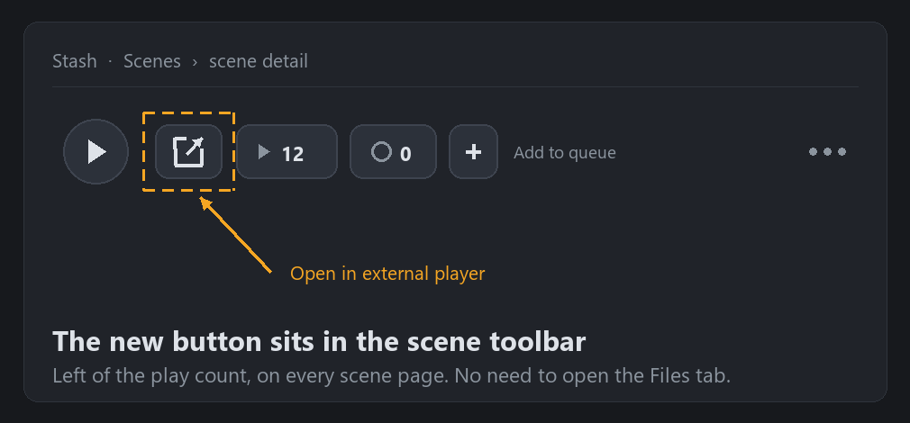

<p align="center" translate="no">
  <a href="README.md">English</a> ·
  <a href="README.zh-CN.md">简体中文</a> ·
  <a href="README.zh-TW.md">繁體中文</a> ·
  <a href="README.ja.md">日本語</a> ·
  <a href="README.ko.md">한국어</a> ·
  <a href="README.ru.md">Русский</a> ·
  <a href="README.de.md">Deutsch</a><br>
  <b>Español</b> ·
  <a href="README.fr.md">Français</a> ·
  <a href="README.pt.md">Português</a> ·
  <a href="README.tr.md">Türkçe</a> ·
  <a href="README.vi.md">Tiếng Việt</a> ·
  <a href="README.th.md">ไทย</a> ·
  <a href="README.el.md">Ελληνικά</a>
</p>

# Stash Open Media Player Remote

**Un clic y la escena de Stash se abre en el reproductor que ya usas — VLC, MPV, MPC-HC, SMPlayer, PotPlayer —. Reproduce el archivo original y no un flujo transcodificado por el navegador, y sigue funcionando aunque Stash esté en Docker sobre un NAS.**

## Qué hace este complemento

Cada página de escena recibe un botón **Abrir en reproductor externo** en su barra de herramientas. Al pulsarlo, la ruta real del archivo de esa escena se envía al reproductor de tu equipo.



*La barra de herramientas de la escena: el botón nuevo queda justo a la izquierda del contador.*

- **Un clic y el botón siempre visible** — está en la barra de herramientas de la escena, junto al contador de reproducciones; no hace falta abrir la pestaña «Archivos».
- **Cualquier reproductor** — sirve cualquiera que se pueda lanzar como «ejecutable + ruta de archivo»: VLC, MPV, MPC-HC/BE, SMPlayer, PotPlayer… Solo hay que indicar la ruta completa del ejecutable.
- **Modo local** — Stash y el reproductor en el mismo equipo: el servidor de Stash lanza el reproductor directamente.
- **Modo remoto** — Stash en Docker / Unraid / NAS / otro equipo: el navegador entrega un enlace `stashopenmediaplayerremote://` a un pequeño asistente instalado en tu equipo, que abre el reproductor en local. El servidor no necesita acceso a tu escritorio.
- **Asignación de rutas** — reescribe rutas del contenedor a rutas reales, por ejemplo `/data` → `//NAS/stash`.
- **Formato según el reproductor** — URL `file://` o ruta nativa, detectado automáticamente (VLC y MPC se comportan distinto) o forzado con `keep` / `remove`.
- **Contador de reproducciones (opcional)** — abrir en externo también cuenta como reproducción.

### ¿Por qué usar un reproductor externo?

El reproductor integrado de Stash tiene que transcodificar o depender de los códecs del navegador: mucha carga de CPU y poca compatibilidad con subtítulos ASS y HDR. Un reproductor de escritorio abre el archivo original con decodificación por hardware, cambio de subtítulos y pistas de audio, HDR y atajos de teclado, y libera al servidor de la transcodificación.

## Instalación

1. En **Ajustes → Complementos → Disponibles → Añadir origen**, añade este origen:

```text
Nombre:
stashOpenMediaPlayerRemote

URL:
https://raw.githubusercontent.com/bslnssb/stashOpenMediaPlayerRemote/refs/heads/main/index.yml
```


2. Instala **Stash Open Media Player Remote** desde ese origen.


3. En los ajustes del complemento, pon en **Media Player Path** la ruta completa del reproductor, por ejemplo `C:\Program Files\SMPlayer\smplayer.exe`.
4. Solo para el modo remoto: activa **Use Remote Protocol Handler** y ejecuta el asistente una vez en el equipo donde está el reproductor (ver abajo).
5. Recarga Stash en el navegador con <kbd>Ctrl</kbd>+<kbd>F5</kbd>.

## Ajustes

| Ajuste | Para qué sirve |
|---|---|
| **Media Player Path** | Ruta completa del ejecutable, p. ej. `C:\Program Files\SMPlayer\smplayer.exe` |
| **File URL Prefix Mode** | `auto` (por defecto: VLC recibe `file://`, MPC una ruta nativa), `keep` (siempre `file://`), `remove` (siempre ruta nativa) |
| **Use Remote Protocol Handler** | Actívalo con Docker / Unraid / NAS / Stash remoto: lanza el asistente del equipo en lugar del servidor |
| **Path Mapping From / To** | Reescritura opcional de prefijo, p. ej. `/data` → `//NAS/stash` |
| **Increment Play Count** | Suma una reproducción al abrir en externo |


## Modo remoto (Docker, Unraid, NAS)

El navegador abre `stashopenmediaplayerremote://open?player=...&path=...` y el reproductor arranca en tu equipo. El asistente se instala una vez por equipo:

```bash
python install-stashOpenMediaPlayerRemote.py
```

El script registra el protocolo en el registro de Windows o como manejador `.desktop` en Linux mediante `xdg-mime`. En Windows no hacen falta permisos de administrador.


La primera vez que pulses el botón, acepta el aviso del navegador.

## Problemas frecuentes

### No se encuentra el archivo

- **Path Mapping From** coincide con la ruta que guarda Stash (la que se ve en la página de la escena).
- **Path Mapping To** apunta a un recurso que este equipo puede abrir de verdad.
- La ruta resultante se abre desde el explorador de archivos.

Ejemplo: `/data` → `//network_path/stash`

### El botón no aparece

Recarga Stash después de instalar o actualizar el complemento. Si sigue sin salir, ve a **Ajustes → Complementos** y recarga los complementos: tras una actualización hay que refrescar tanto la página como la lista.

### Quitar el aviso de protocolo del navegador (opcional)

Los navegadores basados en Chromium preguntan cada vez que se abre `stashopenmediaplayerremote://`. Puedes permitirlo siempre con la directiva `AutoLaunchProtocolsFromOrigins` (el JSON está en el README en inglés, sección Troubleshooting). Clave de directiva: Chrome `HKEY_CURRENT_USER\Software\Policies\Google\Chrome`, Edge `HKEY_CURRENT_USER\Software\Policies\Microsoft\Edge`. Las versiones portables pueden ignorar las directivas del sistema; es totalmente opcional.

## Qué cambia este fork (frente al upstream v1.0.2)

Este repositorio es un **fork no oficial**. El complemento es obra de [MrArgparse](https://github.com/MrArgparse/stashOpenMediaPlayerRemote); aquí se corrige para que vuelva a funcionar en Windows con rutas no ASCII y se distribuye de forma fiable.

- **Cuelgue con rutas no ASCII (corrección principal)** — Stash envía JSON UTF-8 válido, pero Python en Windows lo decodificaba con la página de códigos ANSI (cp936 / cp932 / cp949 / cp1251…): los caracteres se corrompían y se perdía una de las dos barras invertidas de `\\`, así que `json.loads` lanzaba `Invalid \escape`, la tarea terminaba con código 1 y el reproductor nunca se abría. Ahora el backend lee los bytes crudos de stdin y decodifica en UTF-8.
- **Clic sin reacción** — la ruta se obtiene con la consulta GraphQL del mismo origen `findScene(id){files{path}}`; el DOM/XPath queda solo como respaldo. Un fallo al leer la configuración ya no mata el manejador en silencio.
- **Botón que desaparecía** — se inyecta en `.scene-toolbar` y se reengancha con un `MutationObserver`, así que sobrevive a la navegación SPA y al redibujado de la barra.
- **Errores visibles** — cualquier fallo muestra un aviso con el motivo en lugar de «no pasa nada».
- **Sin filtración de credenciales** — el registro ya no vuelca `server_connection` (cookie de sesión y ApiKey).
- **Distribución verificable** — zip reproducible, `index.yml` ligado al hash del paquete, autocomprobación de integridad y notas en 13 idiomas.

Los parches listos para el upstream están en [patches/](patches/); licencia y autoría en [NOTICE.md](NOTICE.md). Cuando el upstream publique la corrección, conviene volver a su origen.

## Compatibilidad

- Probado con **Windows 11 + Stash v0.31.1** (Chrome / Edge). Usa solo la `PluginApi` estándar y una tarea `raw`, así que las versiones recientes de Stash deberían funcionar.
- El asistente de protocolo se instala en **Windows** (registro) y **Linux** (`xdg-mime`). En macOS funciona el modo local, pero el asistente aún no lo instala el script.
- En Docker / Unraid / NAS hace falta el **modo remoto** y la asignación de rutas.
