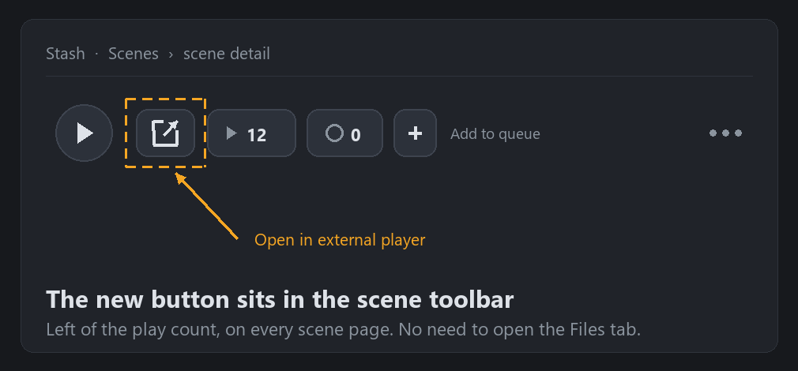

<p align="center" translate="no">
  <a href="README.md">English</a> ·
  <a href="README.zh-CN.md">简体中文</a> ·
  <a href="README.zh-TW.md">繁體中文</a> ·
  <a href="README.ja.md">日本語</a> ·
  <a href="README.ko.md">한국어</a> ·
  <a href="README.ru.md">Русский</a> ·
  <a href="README.de.md">Deutsch</a><br>
  <a href="README.es.md">Español</a> ·
  <a href="README.fr.md">Français</a> ·
  <a href="README.pt.md">Português</a> ·
  <a href="README.tr.md">Türkçe</a> ·
  <a href="README.vi.md">Tiếng Việt</a> ·
  <b>ไทย</b> ·
  <a href="README.el.md">Ελληνικά</a>
</p>

# Stash Open Media Player Remote

**คลิกเดียวเปิดฉากใน Stash ด้วยโปรแกรมเล่นที่คุณใช้อยู่ — VLC, MPV, MPC-HC, SMPlayer, PotPlayer เปิดไฟล์ต้นฉบับ ไม่ใช่สตรีมที่เบราว์เซอร์แปลงรหัส และยังใช้ได้แม้ Stash รันใน Docker บน NAS**

## ปลั๊กอินนี้ทำอะไร

ทุกหน้าฉาก (Scene) จะมีปุ่ม **เปิดด้วยโปรแกรมเล่นภายนอก** อยู่บนแถบเครื่องมือ คลิกครั้งเดียวจะส่งพาธไฟล์จริงของฉากนั้นไปยังโปรแกรมเล่นบนเครื่องคุณ



*แถบเครื่องมือของฉาก: ปุ่มใหม่อยู่ทางซ้ายของปุ่มนับจำนวนครั้งที่ดู*

- **คลิกเดียว ปุ่มอยู่ตลอด** — ปุ่มอยู่ในแถบเครื่องมือของฉาก ข้างปุ่มนับจำนวนครั้งที่ดู ไม่ต้องเปิดแท็บ «ไฟล์» ก่อน
- **ใช้โปรแกรมเล่นอะไรก็ได้** — ขอเพียงเปิดได้แบบ «ไฟล์ exe + พาธไฟล์» เช่น VLC, MPV, MPC-HC/BE, SMPlayer, PotPlayer … คุณเพียงกรอกพาธเต็มของไฟล์ exe
- **โหมดเครื่องเดียวกัน** — Stash และโปรแกรมเล่นอยู่เครื่องเดียวกัน เซิร์ฟเวอร์ Stash เปิดโปรแกรมเล่นให้เอง
- **โหมดระยะไกล** — Stash อยู่ใน Docker / Unraid / NAS / เครื่องอื่น: เบราว์เซอร์ส่งลิงก์ `stashopenmediaplayerremote://` ให้ตัวช่วยเล็ก ๆ ที่ติดตั้งบนเครื่องคุณ แล้วตัวช่วยจะเปิดโปรแกรมเล่นในเครื่อง เซิร์ฟเวอร์ไม่ต้องเข้าถึงเดสก์ท็อปของคุณ
- **แมปพาธ** — แปลงพาธในคอนเทนเนอร์เป็นพาธจริง เช่น `/data` → `//NAS/stash`
- **รูปแบบพาธตามโปรแกรมเล่น** — ส่ง URL `file://` หรือพาธปกติ ตรวจจับอัตโนมัติ (VLC กับ MPC ต่างกัน) หรือบังคับด้วย `keep` / `remove`
- **นับจำนวนครั้งที่ดู (เลือกได้)** — เปิดด้วยโปรแกรมภายนอกก็นับเป็นการดูหนึ่งครั้ง

### ทำไมต้องใช้โปรแกรมเล่นภายนอก

โปรแกรมเล่นในตัวของ Stash ต้องแปลงรหัสหรือพึ่งตัวถอดรหัสของเบราว์เซอร์: กิน CPU สูง รองรับซับ ASS และ HDR ได้จำกัด โปรแกรมเล่นบนเดสก์ท็อปเปิดไฟล์ต้นฉบับด้วยการถอดรหัสฮาร์ดแวร์ สลับซับและแทร็กเสียง รองรับ HDR และคีย์ลัดได้ทันที ทั้งยังลดภาระการแปลงรหัสของเซิร์ฟเวอร์

## การติดตั้ง

1. ใน **ตั้งค่า → ปลั๊กอิน → ที่ใช้ได้ → เพิ่มแหล่ง** ให้เพิ่มแหล่งนี้:

```text
ชื่อ:
stashOpenMediaPlayerRemote

URL:
https://raw.githubusercontent.com/bslnssb/stashOpenMediaPlayerRemote/refs/heads/main/index.yml
```


2. ติดตั้ง **Stash Open Media Player Remote** จากแหล่งนี้


3. ในการตั้งค่าปลั๊กอิน กรอก **Media Player Path** เป็นพาธเต็มของโปรแกรมเล่น เช่น `C:\Program Files\SMPlayer\smplayer.exe`
4. เฉพาะโหมดระยะไกล: เปิด **Use Remote Protocol Handler** และรันตัวช่วยหนึ่งครั้งบนเครื่องที่มีโปรแกรมเล่น (ดูด้านล่าง)
5. รีโหลด Stash ในเบราว์เซอร์ด้วย <kbd>Ctrl</kbd>+<kbd>F5</kbd>

## การตั้งค่า

| การตั้งค่า | ผล |
|---|---|
| **Media Player Path** | พาธเต็มของไฟล์ exe เช่น `C:\Program Files\SMPlayer\smplayer.exe` |
| **File URL Prefix Mode** | `auto` (ค่าเริ่มต้น: VLC ได้ `file://`, MPC ได้พาธปกติ), `keep` (เป็น `file://` เสมอ), `remove` (เป็นพาธปกติเสมอ) |
| **Use Remote Protocol Handler** | เปิดสำหรับ Docker / Unraid / NAS / Stash ระยะไกล: ตัวช่วยบนเครื่องจะเป็นผู้เปิดโปรแกรมเล่น ไม่ใช่เซิร์ฟเวอร์ |
| **Path Mapping From / To** | แทนที่คำนำหน้าพาธ (ไม่บังคับ) เช่น `/data` → `//NAS/stash` |
| **Increment Play Count** | เพิ่มจำนวนครั้งที่ดูเมื่อเปิดด้วยโปรแกรมภายนอก |


## โหมดระยะไกล (Docker, Unraid, NAS)

เบราว์เซอร์จะเปิด `stashopenmediaplayerremote://open?player=...&path=...` แล้วโปรแกรมเล่นจะเปิดบนเครื่องคุณ ติดตั้งตัวช่วยครั้งเดียวต่อเครื่อง:

```bash
python install-stashOpenMediaPlayerRemote.py
```

สคริปต์จะลงทะเบียนโปรโตคอลในรีจิสทรีของ Windows หรือเป็นตัวจัดการ `.desktop` บน Linux ผ่าน `xdg-mime` บน Windows ไม่ต้องใช้สิทธิ์ผู้ดูแลระบบ


ครั้งแรกที่กดปุ่ม ให้กดยอมรับในหน้าต่างยืนยันของเบราว์เซอร์

## แก้ปัญหา

### หาไฟล์สื่อไม่พบ

- **Path Mapping From** ตรงกับพาธที่ Stash เก็บไว้ (พาธที่แสดงบนหน้าฉาก)
- **Path Mapping To** ชี้ไปยังแชร์ที่เครื่องนี้เปิดได้จริง
- พาธหลังแมปแล้วเปิดได้จาก File Explorer

ตัวอย่าง: `/data` → `//network_path/stash`

### ปุ่มไม่ปรากฏ

รีโหลด Stash หลังติดตั้งหรืออัปเดตปลั๊กอิน หากยังไม่ขึ้น ให้ไปที่ **ตั้งค่า → ปลั๊กอิน** แล้วโหลดปลั๊กอินใหม่ หลังอัปเดตต้องรีเฟรชทั้งหน้าและรายการปลั๊กอิน

### ปิดหน้าต่างยืนยันโปรโตคอลของเบราว์เซอร์ (ไม่บังคับ)

เบราว์เซอร์ตระกูล Chromium จะถามทุกครั้งที่เปิด `stashopenmediaplayerremote://` อนุญาตถาวรได้ด้วยนโยบาย `AutoLaunchProtocolsFromOrigins` (JSON อยู่ใน README ภาษาอังกฤษ หัวข้อ Troubleshooting) คีย์นโยบาย: Chrome `HKEY_CURRENT_USER\Software\Policies\Google\Chrome`, Edge `HKEY_CURRENT_USER\Software\Policies\Microsoft\Edge` เวอร์ชันพกพาอาจไม่สนใจนโยบายระบบ และขั้นนี้เป็นเพียงตัวเลือก

## fork นี้แก้อะไร (เทียบกับ upstream v1.0.2)

ที่เก็บนี้เป็น **fork ที่ไม่เป็นทางการ** ตัวปลั๊กอินเป็นผลงานของ [MrArgparse](https://github.com/MrArgparse/stashOpenMediaPlayerRemote) ที่นี่แก้ให้กลับมาใช้ได้บน Windows ที่มีพาธไม่ใช่ ASCII และจัดให้แจกจ่ายได้อย่างเชื่อถือได้

- **แครชเมื่อพาธไม่ใช่ ASCII (การแก้หลัก)** — Stash ส่ง JSON แบบ UTF-8 ที่ถูกต้อง แต่ Python บน Windows ถอดรหัสด้วยโค้ดเพจ ANSI (cp936 / cp932 / cp949 / cp1251 …) ตัวอักษรเพี้ยนและแบ็กสแลชหนึ่งตัวในคู่ `\\` หายไป `json.loads` จึงโยน `Invalid \escape` งานจบด้วย exit 1 และโปรแกรมเล่นไม่เคยเปิด ตอนนี้แบ็กเอนด์อ่านไบต์ดิบจาก stdin แล้วถอดรหัสเป็น UTF-8
- **กดแล้วไม่ตอบสนอง** — ดึงพาธด้วยคิวรี GraphQL แหล่งเดียวกัน `findScene(id){files{path}}` ส่วน DOM/XPath เป็นเพียงตัวสำรอง ข้อผิดพลาดตอนอ่านการตั้งค่าไม่ทำให้ตัวจัดการตายเงียบอีก
- **ปุ่มหาย** — ใส่ไว้ใน `.scene-toolbar` และเติมซ้ำด้วย `MutationObserver` จึงอยู่รอดทั้งการเปลี่ยนหน้าแบบ SPA และการวาดแถบเครื่องมือใหม่
- **เห็นข้อผิดพลาดชัด** — ทุกความล้มเหลวแสดง toast พร้อมสาเหตุ ไม่ใช่ «กดแล้วเงียบ»
- **ไม่รั่วข้อมูลรับรอง** — บันทึกไม่พิมพ์ `server_connection` (คุกกี้เซสชัน, ApiKey) อีก
- **แจกจ่ายตรวจสอบได้** — zip ที่สร้างซ้ำได้, `index.yml` ผูกกับแฮชของแพ็กเกจ, ตรวจสอบความสมบูรณ์ด้วยตัวเอง, เอกสาร 13 ภาษา

แพตช์ที่พร้อมส่ง upstream อยู่ที่ [patches/](patches/) สิทธิ์และการให้เครดิตอยู่ที่ [NOTICE.md](NOTICE.md) หาก upstream ออกเวอร์ชันที่แก้แล้ว ควรกลับไปใช้แหล่งของ upstream

## ความเข้ากันได้

- ทดสอบกับ **Windows 11 + Stash v0.31.1** (Chrome / Edge) ปลั๊กอินใช้เพียง `PluginApi` มาตรฐานและงานแบบ `raw` เวอร์ชัน Stash ใหม่จึงควรใช้ได้
- ตัวช่วยโปรโตคอลติดตั้งบน **Windows** (รีจิสทรี) และ **Linux** (`xdg-mime`) บน macOS ใช้โหมดเครื่องเดียวกันได้ แต่สคริปต์ยังไม่ติดตั้งตัวช่วย
- Docker / Unraid / NAS ต้องใช้ **โหมดระยะไกล** และการแมปพาธ
