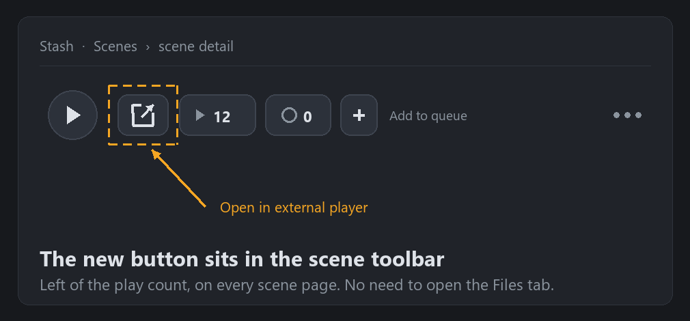

<p align="center" translate="no">
  <a href="README.md">English</a> ·
  <a href="README.zh-CN.md">简体中文</a> ·
  <a href="README.zh-TW.md">繁體中文</a> ·
  <a href="README.ja.md">日本語</a> ·
  <a href="README.ko.md">한국어</a> ·
  <a href="README.ru.md">Русский</a> ·
  <a href="README.de.md">Deutsch</a><br>
  <a href="README.es.md">Español</a> ·
  <a href="README.fr.md">Français</a> ·
  <a href="README.pt.md">Português</a> ·
  <b>Türkçe</b> ·
  <a href="README.vi.md">Tiếng Việt</a> ·
  <a href="README.th.md">ไทย</a> ·
  <a href="README.el.md">Ελληνικά</a>
</p>

# Stash Open Media Player Remote

**Tek tıkla Stash sahnesini kendi oynatıcınızda açın — VLC, MPV, MPC-HC, SMPlayer, PotPlayer. Tarayıcıda dönüştürülmüş akış yerine orijinal dosya oynatılır ve Stash Docker içinde bir NAS üzerinde çalışsa bile kullanılabilir.**

## Bu eklenti ne yapar

Her sahne sayfasının araç çubuğuna **Harici oynatıcıda aç** düğmesi eklenir. Tek tıkla sahnenin gerçek dosya yolu bilgisayarınızdaki oynatıcıya gönderilir.



*Sahne araç çubuğu: yeni düğme oynatma sayacının hemen solunda.*

- **Tek tık, düğme her zaman görünür** — sahne araç çubuğunda oynatma sayacının yanında durur; «Dosyalar» sekmesini açmanız gerekmez.
- **Her oynatıcı** — «exe + dosya yolu» ile başlatılabilen her şey: VLC, MPV, MPC-HC/BE, SMPlayer, PotPlayer… Yalnızca oynatıcının tam yolunu girmeniz yeterli.
- **Yerel mod** — Stash ve oynatıcı aynı bilgisayarda: oynatıcıyı Stash sunucusu başlatır.
- **Uzak mod** — Stash Docker / Unraid / NAS / başka bir bilgisayarda: tarayıcı `stashopenmediaplayerremote://` bağlantısını bilgisayarınızdaki küçük bir yardımcıya devreder, yardımcı oynatıcıyı yerelde başlatır. Sunucunun masaüstünüze erişmesi gerekmez.
- **Yol eşleme** — konteyner yollarını gerçek yollara çevirir, ör. `/data` → `//NAS/stash`.
- **Oynatıcıya göre yol biçimi** — `file://` adresi ya da yerel yol; otomatik algılanır (VLC ve MPC farklı davranır) veya `keep` / `remove` ile zorlanır.
- **Oynatma sayacı (isteğe bağlı)** — harici açma da bir oynatma sayılır.

### Neden harici oynatıcı?

Stash'in yerleşik oynatıcısı ya dönüştürme yapar ya da tarayıcı kodeklerine bağlıdır: yüksek CPU kullanımı, ASS altyazı ve HDR desteği zayıf. Masaüstü oynatıcı orijinal dosyayı donanım kod çözme ile açar; altyazı ve ses parçası değiştirme, HDR ve klavye kısayolları hazırdır, sunucudaki dönüştürme yükü de kalkar.

## Kurulum

1. **Ayarlar → Eklentiler → Kullanılabilir → Kaynak ekle** bölümünde bu kaynağı ekleyin:

```text
Ad:
stashOpenMediaPlayerRemote

URL:
https://raw.githubusercontent.com/bslnssb/stashOpenMediaPlayerRemote/refs/heads/main/index.yml
```


2. Bu kaynaktan **Stash Open Media Player Remote** eklentisini kurun.


3. Eklenti ayarlarında **Media Player Path** alanına oynatıcının tam yolunu yazın, ör. `C:\Program Files\SMPlayer\smplayer.exe`.
4. Yalnızca uzak mod: **Use Remote Protocol Handler** seçeneğini açın ve oynatıcının bulunduğu bilgisayarda yardımcıyı bir kez çalıştırın (aşağıda).
5. Tarayıcıda <kbd>Ctrl</kbd>+<kbd>F5</kbd> ile Stash'i yenileyin.

## Ayarlar

| Ayar | Ne yapar |
|---|---|
| **Media Player Path** | Oynatıcı exe'sinin tam yolu, ör. `C:\Program Files\SMPlayer\smplayer.exe` |
| **File URL Prefix Mode** | `auto` (varsayılan: VLC `file://`, MPC yerel yol alır), `keep` (her zaman `file://`), `remove` (her zaman yerel yol) |
| **Use Remote Protocol Handler** | Docker / Unraid / NAS / uzak Stash için açın: oynatıcıyı sunucu değil bilgisayardaki yardımcı başlatır |
| **Path Mapping From / To** | İsteğe bağlı önek değiştirme, ör. `/data` → `//NAS/stash` |
| **Increment Play Count** | Harici açmada oynatma sayacını bir artırır |


## Uzak mod (Docker, Unraid, NAS)

Tarayıcı `stashopenmediaplayerremote://open?player=...&path=...` adresini açar ve oynatıcı kendi bilgisayarınızda başlar. Yardımcı her bilgisayara bir kez kurulur:

```bash
python install-stashOpenMediaPlayerRemote.py
```

Betik protokolü Windows kayıt defterine ya da Linux'ta `xdg-mime` ile `.desktop` işleyicisi olarak kaydeder. Windows'ta yönetici yetkisi gerekmez.


Düğmeye ilk basışınızda tarayıcının izin isteğini onaylayın.

## Sorun giderme

### Medya dosyası bulunamıyor

- **Path Mapping From** Stash'in sakladığı yol ile aynı mı (sahne sayfasında görünen yol)?
- **Path Mapping To** bu bilgisayarın gerçekten açabildiği bir paylaşıma mı işaret ediyor?
- Eşlenmiş yolu dosya yöneticisine yapıştırınca dosya açılıyor mu?

Örnek: `/data` → `//network_path/stash`

### Düğme görünmüyor

Eklentiyi kurduktan veya güncelledikten sonra Stash'i yenileyin. Yine yoksa **Ayarlar → Eklentiler** bölümünden eklentileri yeniden yükleyin; güncellemeden sonra hem sayfa hem eklenti listesi yenilenmelidir.

### Tarayıcı protokol uyarısını kapatma (isteğe bağlı)

Chromium tabanlı tarayıcılar `stashopenmediaplayerremote://` her açıldığında onay ister. `AutoLaunchProtocolsFromOrigins` ilkesiyle kalıcı izin verebilirsiniz (JSON, İngilizce README'nin Troubleshooting bölümünde). İlke anahtarı: Chrome `HKEY_CURRENT_USER\Software\Policies\Google\Chrome`, Edge `HKEY_CURRENT_USER\Software\Policies\Microsoft\Edge`. Taşınabilir sürümler sistem ilkelerini yok sayabilir; bu adım tamamen isteğe bağlıdır.

## Bu fork neyi değiştiriyor (upstream v1.0.2'ye göre)

Bu depo **resmî olmayan bir fork**. Eklentinin kendisi [MrArgparse](https://github.com/MrArgparse/stashOpenMediaPlayerRemote) eseridir; burada ASCII dışı yollar içeren Windows'ta yeniden çalışır hâle getirildi ve güvenilir biçimde dağıtılıyor.

- **ASCII dışı yollarda çökme (ana düzeltme)** — Stash geçerli UTF-8 JSON gönderiyor, ancak Windows'taki Python bunu ANSI kod sayfasıyla (cp936 / cp932 / cp949 / cp1251…) çözüyordu: karakterler bozuluyor ve `\\` çiftinin bir ters bölüsü yutuluyordu; `json.loads` `Invalid \escape` hatası veriyor, görev exit 1 ile bitiyor ve oynatıcı hiç açılmıyordu. Arka uç artık stdin'i ham bayt olarak okuyup UTF-8 ile çözüyor.
- **Tıklayınca tepki yok** — yol, aynı kaynaklı GraphQL `findScene(id){files{path}}` sorgusuyla alınıyor; DOM/XPath yalnızca yedek. Ayar sorgusu hatası artık işleyiciyi sessizce öldürmüyor.
- **Kaybolan düğme** — `.scene-toolbar` içine ekleniyor ve `MutationObserver` ile yeniden iliştiriliyor; SPA geçişlerinde ve araç çubuğu yeniden çizildiğinde kalıcı.
- **Görünür hatalar** — her başarısızlık nedeniyle birlikte toast gösteriyor.
- **Kimlik bilgisi sızıntısı yok** — günlüğe artık `server_connection` (oturum çerezi, ApiKey) yazılmıyor.
- **Dağıtım hijyeni** — yeniden üretilebilir zip, `index.yml` paket hash'ine bağlı, bütünlük öz denetimi, 13 dilde notlar.

Upstream'e gönderilmeye hazır yamalar [patches/](patches/), lisans ve atıf [NOTICE.md](NOTICE.md) içinde. Upstream düzeltmeyi yayınlarsa kaynağına dönmeniz önerilir.

## Uyumluluk

- **Windows 11 + Stash v0.31.1** (Chrome / Edge) ile test edildi. Yalnızca standart `PluginApi` ve bir `raw` görevi kullanır; yeni Stash sürümlerinde de çalışmalıdır.
- Protokol yardımcısı **Windows** (kayıt defteri) ve **Linux** (`xdg-mime`) üzerinde kurulur. macOS'ta yerel mod çalışır ancak yardımcı henüz betikle kurulmuyor.
- Docker / Unraid / NAS için **uzak mod** ve yol eşleme gerekir.
