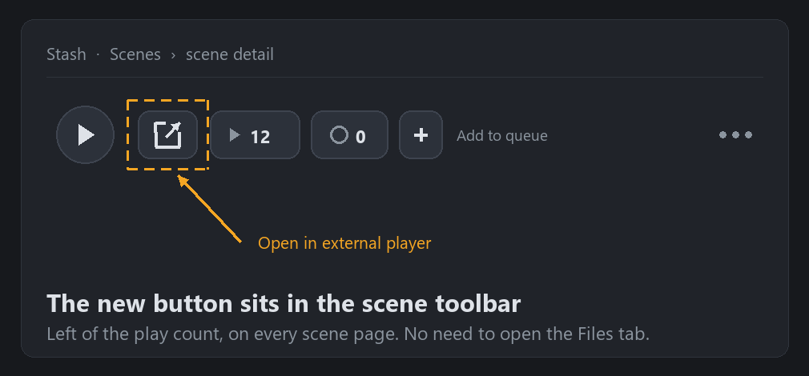

<p align="center" translate="no">
  <a href="README.md">English</a> ·
  <b>简体中文</b> ·
  <a href="README.zh-TW.md">繁體中文</a> ·
  <a href="README.ja.md">日本語</a> ·
  <a href="README.ko.md">한국어</a> ·
  <a href="README.ru.md">Русский</a> ·
  <a href="README.de.md">Deutsch</a><br>
  <a href="README.es.md">Español</a> ·
  <a href="README.fr.md">Français</a> ·
  <a href="README.pt.md">Português</a> ·
  <a href="README.tr.md">Türkçe</a> ·
  <a href="README.vi.md">Tiếng Việt</a> ·
  <a href="README.th.md">ไทย</a> ·
  <a href="README.el.md">Ελληνικά</a>
</p>

# Stash 外部播放器（Open Media Player Remote）

**一个按钮，把 Stash 里的影片丢给你自己的播放器 —— VLC、MPV、MPC-HC、SMPlayer、PotPlayer 都行。播的是硬盘上的原始文件，不是浏览器转码流；Stash 装在 Docker / NAS 上也能用。**

## 这个插件是干什么的

每个场景（Scene）页面的工具栏里会多出一个「用外部播放器打开」按钮。点一下，这个场景的真实文件路径就被送进你电脑上的播放器。



*场景工具栏示意：新按钮就在播放次数按钮左边。*

- **一键打开、按钮常在** —— 按钮就在场景工具栏里、和播放次数按钮挨着，任何场景页都有，不需要先切到「文件」标签页。
- **播放器随便挑** —— 只要能用「可执行文件 + 文件路径」在命令行启动就行：VLC、MPV、MPC-HC/BE、SMPlayer、PotPlayer……你只需要填播放器 exe 的完整路径。
- **本机模式** —— Stash 和播放器在同一台电脑上，由 Stash 服务端直接拉起播放器。
- **远程模式** —— Stash 跑在 Docker / Unraid / NAS / 另一台机器上：浏览器把 `stashopenmediaplayerremote://` 链接交给装在你电脑上的小助手，由它在本机启动播放器。服务器不需要能访问你的桌面。
- **路径映射** —— 把容器里的路径换成真实路径，例如 `/data` → `//NAS/stash`。
- **按播放器自动选路径格式** —— 发 `file://` URL 还是原生路径，默认按播放器自动判断（VLC 偏 URL、MPC 偏路径），也可以用 `keep` / `remove` 强制。
- **可选记录播放次数** —— 用外部播放器打开也算一次观看。

### 为什么不用自带播放器？

Stash 自带的播放器要么转码、要么吃浏览器解码能力：CPU 占用高，ASS 字幕和 HDR 支持也有限。桌面播放器直接播原始文件，硬件解码、多音轨、字幕样式、HDR、快捷键都是现成的，还把转码压力从服务器上卸掉了。

## 安装

1. 在 **设置 → 插件 → 可用插件 → 添加源** 里添加插件源：

```text
名称：
stashOpenMediaPlayerRemote

地址：
https://raw.githubusercontent.com/bslnssb/stashOpenMediaPlayerRemote/refs/heads/main/index.yml
```


2. 从这个源安装 **Stash Open Media Player Remote**。


3. 打开插件设置，把 **Media Player Path** 填成播放器的完整路径，例如 `C:\Program Files\SMPlayer\smplayer.exe`。
4. 只有远程模式需要：勾选 **Use Remote Protocol Handler**，并在装了播放器的那台电脑上运行一次小助手（见下）。
5. 在浏览器里按 <kbd>Ctrl</kbd>+<kbd>F5</kbd> 强制刷新 Stash。

## 设置项

| 设置 | 作用 |
|---|---|
| **Media Player Path** | 播放器 exe 的完整路径，例如 `C:\Program Files\SMPlayer\smplayer.exe` |
| **File URL Prefix Mode** | `auto`（默认：VLC 发 `file://`、MPC 发原生路径）、`keep`（一律 `file://`）、`remove`（一律原生路径） |
| **Use Remote Protocol Handler** | Docker / Unraid / NAS / 远程 Stash 打开：让浏览器去启动本机小助手，而不是让服务端启动 |
| **Path Mapping From / To** | 可选的前缀替换，例如 `/data` → `//NAS/stash` |
| **Increment Play Count** | 外部打开时给这个场景加一次播放次数 |


## 远程模式（Docker / Unraid / NAS）

浏览器会打开 `stashopenmediaplayerremote://open?player=...&path=...`，由本机启动播放器。每台要播放的电脑上装一次：

```bash
python install-stashOpenMediaPlayerRemote.py
```

脚本会在 Windows 注册表里注册协议，或在 Linux 下写一个 `.desktop` 并用 `xdg-mime` 注册。Windows 上不需要管理员权限。


第一次点按钮时，记得在浏览器弹窗里点「允许」。

## 常见问题

### 提示找不到媒体文件

逐项确认：

- **Path Mapping From** 和 Stash 里存的路径一致（就是场景页面上显示的那个路径）。
- **Path Mapping To** 指向这台电脑真能打开的共享目录。
- 把映射后的路径粘到资源管理器 / 文件管理器里，文件能直接打开。

例如：`/data` → `//network_path/stash`

### 按钮不出现

安装或更新插件后要刷新 Stash；还不行就去 **设置 → 插件** 重新加载插件。更新之后「页面」和「插件列表」都得各刷新一次。

### 关掉浏览器的协议确认弹窗（可选）

Chromium 系浏览器每次打开 `stashopenmediaplayerremote://` 都会问一次。可以用 `AutoLaunchProtocolsFromOrigins` 策略永久放行：

```json
[
  {
    "protocol": "stashopenmediaplayerremote",
    "allowed_origins": [
      "http://YOUR-STASH-SERVER:9999"
    ]
  }
]
```

在你的浏览器的策略注册表项下，新建字符串值 `AutoLaunchProtocolsFromOrigins`，内容填上面的 JSON：

| 浏览器 | 注册表位置（Windows） | 策略页面 |
|---|---|---|
| Chromium | `HKEY_CURRENT_USER\Software\Policies\Chromium` | `chrome://policy` |
| Google Chrome | `HKEY_CURRENT_USER\Software\Policies\Google\Chrome` | `chrome://policy` |
| Microsoft Edge | `HKEY_CURRENT_USER\Software\Policies\Microsoft\Edge` | `edge://policy` |
| Vivaldi | `HKEY_CURRENT_USER\Software\Policies\Vivaldi` | `vivaldi://policy` |
| Brave | `HKEY_CURRENT_USER\Software\Policies\BraveSoftware\Brave` | `brave://policy` |

重启浏览器，在策略页面确认这项显示为 **已设置 / Set**。便携版浏览器可能忽略系统策略；这一步完全是可选的。

## 这个 fork 改了什么（相对上游 v1.0.2）

本仓库是**非官方分支**。插件本身是 [MrArgparse](https://github.com/MrArgparse/stashOpenMediaPlayerRemote) 的作品；这里做的是让它在中文 / 非 ASCII 路径的 Windows 上重新可用，并把它稳定地分发出去。

- **非 ASCII 路径崩溃（主要修复）** —— Stash 送出的是合法 UTF-8 JSON，但 Windows 上的 Python 用系统 ANSI 代码页（cp936 / cp932 / cp949 / cp1251……）去解码：中文变乱码，而且某个字节会把紧随其后的一个反斜杠「吃掉」，`\\` 只剩一个，`json.loads` 抛 `Invalid \escape`，任务以 exit 1 结束，播放器根本不会启动。后端改成直接读 stdin 原始字节并按 UTF-8 解码。
- **点了没反应** —— 路径改为同源 GraphQL `findScene(id){files{path}}` 获取，不再依赖「文件」标签页是否展开；DOM/XPath 只作兜底。配置查询出错也不会再让点击事件静默死掉。
- **按钮时有时无** —— 改为注入 `.scene-toolbar`，并挂 `MutationObserver` 持续补齐，切场景、工具栏重绘都不会丢。
- **错误看得见** —— 任何失败都弹 toast（或 alert）说明原因，不再是「什么也没发生」。
- **不再泄露凭证** —— 插件日志不再把整个 `server_connection`（含 session cookie 与 ApiKey）打进 Stash 日志。
- **分发可验证** —— 固定 mtime 的可复现 zip、`index.yml` 与包哈希绑定、完整性自检、13 语言说明。

可直接提交给上游的补丁（不含仅针对中文的改动）在 [patches/](patches/)；许可与归属见 [NOTICE.md](NOTICE.md)。如果上游发布了修复版，建议改回上游源。

## 兼容性

- 在 **Windows 11 + Stash v0.31.1**（Chrome / Edge）实测通过。插件只用标准 `PluginApi` 和 `raw` 任务，较新的 Stash 版本应当都能用。
- 协议小助手支持 **Windows**（注册表）与 **Linux**（`xdg-mime`）。macOS 上本机模式可用，但协议小助手目前不由脚本安装。
- Docker / Unraid / NAS 部署必须用**远程模式** + 路径映射：插件没办法在容器里启动你桌面上的播放器。

## 工程文档

- [复盘](docs/POSTMORTEM.md) —— 根因、失效时间线、分层根因表、需求池。
- [架构](docs/ARCHITECTURE.md) —— 模块地图、运行时 / 分发 / 门禁三条链路、契约。
- [任务](docs/TASKS.md) —— WBS、依赖图、发布验收清单。
- [证据](docs/EVIDENCE.md) —— 复现步骤与留证。
- [13 语言说明](docs/i18n.md) —— 修复说明的多语言摘要。

这些文档只是派生视图，机制以 `index.yml` 与完整性自检为准。

## 许可与归属

原始插件作者：**MrArgparse** —— <https://github.com/MrArgparse/stashOpenMediaPlayerRemote>。上游仓库没有 `LICENSE`，因此不对上游代码授予任何许可，本 fork 也不会替它重新授权。本 fork 新增的内容以 CC0 1.0 提供，详见 [NOTICE.md](NOTICE.md)。
