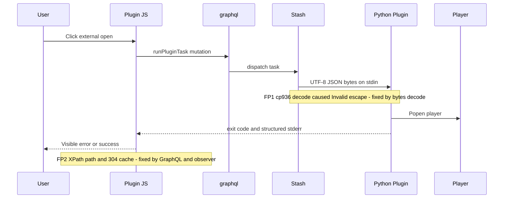
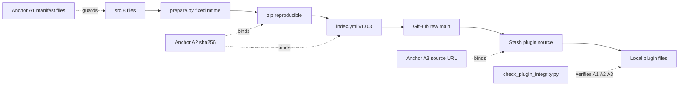
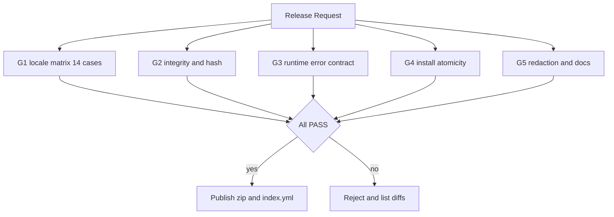

# Stash 外部播放器插件：架构设计

> 适用仓库：fork `bslnssb/stashOpenMediaPlayerRemote`（version 1.0.3）｜核实日期：2026-11-10｜状态：公开发布
> 本文档是**派生视图**。真相源为 `src/`、`index.yml`、`manifest.files` 与校验 / 门禁脚本；删掉全部文档后，防复发机制仍须生效。
> 相关文档：[根因复盘](POSTMORTEM.md) · [任务分解 WBS](TASKS.md) · [复现证据](EVIDENCE.md) · [多语言说明](i18n.md)

> 本地路径说明：文中出现的 `scripts/`、`github-prepare/`、`config.yml` 等均属本地私有工作区的临时路径，只用于还原当时的排查与打包过程，公开仓库并不包含这些文件、也不存在缺件，请勿据此查找；发布物的权威依据是仓库根目录的 `index.yml` 与完整性自检结果，本文及同批文档仅为派生视图。
>
> Note on local paths: mentions of `scripts/`, `github-prepare/`, `config.yml` and similar refer to a private local workspace used only to document the original investigation and packaging steps; they are not part of this public repository and are not missing files, so do not look for them here. The authoritative release artifacts are `index.yml` at the repository root and the integrity self-check; all docs in this batch are derived views.

## 1. 架构总览

**一句话定位**：本项目的交付物不是「一个能用的插件」，而是**一条可验证的插件分发链路**——让「被验证过的那份代码」与「用户正在运行的那份代码」在任何时刻都能用哈希证明同源。历史故障的本质不是 `cp936`，而是缺少这一绑定机制。

| 设计原则 | 落地含义 |
| --- | --- |
| 真相源单一 | `src/`、`index.yml`、`manifest.files`、校验脚本是真相源；`docs/` 与 README 只作派生视图 |
| 门禁优先于提醒 | 约束落在脚本退出码与拒绝条件，不落在「记得做 X」；判定标准：删掉所有文档仍生效 |
| 可复现 | 固定时间戳 → zip sha256 恒定；locale 矩阵任意 clone 可复现 |
| 脱敏边界 | 私有运维脚本与含密钥材料永不进入 fork；发布前置扫描为拒绝条件 |
| 合规最小改动 | 不新增项目级 LICENSE、不对上游代码重新授权、不改插件 ID |

## 2. 仓库与模块地图

| 目录 / 模块 | 职责 | 真相源 / 派生 | 公开 | 机制载体 |
| --- | --- | --- | --- | --- |
| `src/`（8 文件） | 唯一被分发的运行时代码 | 真相源 | 是 | 是 |
| `index.yml` | version + zip sha256 + 分发入口 | 真相源 | 是 | 是 |
| `stashOpenMediaPlayerRemote.zip` | 固定 mtime 的可复现产物 | 派生（源自 `src/`） | 是 | 是 |
| 构建脚本 `prepare.py`（本地工具） | 重建 + 脱敏扫描 + 固定时间戳打包 | 真相源（构建逻辑） | 否（本地工具） | 是 |
| 私有校验 / locale / 探针脚本（本地） | 完整性、真实链路、探针 | 真相源（验证逻辑） | 否（本地私有） | 是 |
| `patches/`（2 补丁 + README） | 与语言无关的通用补丁，供上游评估 | 真相源 | 是 | 部分 |
| `docs/reproduce_locales.py` | 13/14 与 14/14 矩阵可机读复现 | 真相源（证据） | 是 | 是 |
| `docs/EVIDENCE.md`、`docs/i18n*.md` | stdin 字节证据、多语摘要 | 派生视图 | 是 | 说明文档 |
| `NOTICE.md` | parent 与归属声明，不新增 LICENSE | 治理声明 | 是 | 合规载体 |
| `README.md` / `README.zh-CN.md` / `images/` | 入口索引与截图 | 派生视图 | 是 | 说明文档 |
| `config.yml`（本机） | 备份与 metadata 路径，须零绝对路径 | 本机状态 | 否 | 需自检 |
| 含密钥的历史交接材料 | 私有运维记录 | — | **永不上传** | 明确排除 |

**本次新增落盘路径**（发布到 `docs/`，均由真相源派生）：

| 路径 | 定位 |
| --- | --- |
| `docs/POSTMORTEM.md` | 根因复盘、失效时间线、分层根因表、误判勘误表（R14） |
| `docs/ARCHITECTURE.md` | 本文：三条链路、契约、模块地图、约定 |
| `docs/TASKS.md` | WBS 任务分解、依赖图与状态 |

**README 索引要求**：两份 README 顶部增「Documentation」区，链接 `POSTMORTEM` / `ARCHITECTURE` / `TASKS` / `EVIDENCE` / `i18n`，并写明「机制以 `index.yml` 与校验脚本为准，文档仅为派生视图」及插件源 URL；中英文同步。

## 3. 三条链路

### 3.1 运行时数据流

两处历史故障点：**FP1** 入口按平台默认编码 `sys.stdin.read()` 解码、无日志、exit 1 静默；**FP2** XPath 取路径 + 按钮早注入 + JS 304 缓存。现由「字节解码 + GraphQL 取路径 + 全链路 try/catch + 错误上报契约」封死。

### 3.2 发布 / 分发链路

三个一致性锚点：**A1** `manifest.files` 的 8 文件白名单与 5 个修复标记；**A2** zip 与 `index.yml` 的 sha256（固定 mtime 保证恒定）；**A3** 插件源 URL 唯一分发入口。任一不一致，G2 拒绝产出。

### 3.3 校验 / 防复发门禁链路

复盘第 7 节五项「不能靠提醒的事」到门禁组件的映射：

| 机制 | 门禁组件 | 需求 |
| --- | --- | --- |
| M1 统一输入适配层 + CI locale 矩阵，默认编码写法被拒 | G1 `docs/reproduce_locales.py` + 私有 locale 回归脚本 | R01 R09 R10 |
| M2 fork 源 + 完整性校验 + 可复现哈希三者绑定 | G2 私有完整性校验脚本 + `prepare.py` 固定时间戳 | R05 R06 R07 R09 |
| M3 错误上报契约 + 版本化资源与可见生效版本 | G3 故障注入断言（页面可见 errorkind） | R03 R11 |
| M4 安装器原子性与残留态自检，半装态不可达 | G4 生命周期断言（manifest / log / install 不缺失） | R12 |
| M5 脱敏扫描前置拒绝；真相源是脚本、`index.yml`、机读勘误表 | G5 脱敏扫描 + 文档派生校验 + 勘误标记 | R08 R13 R14 |

## 4. 关键契约与数据结构

**`manifest.files`（8 文件逻辑清单）**：下表按**逻辑角色**列出，精确路径以仓库 `src/` 内 `manifest.files` 为唯一真相源，本文不复制文件名以免产生第二份漂移。

| # | 逻辑角色 | 契约要点 |
| --- | --- | --- |
| 1 | 插件定义 yml | 任务与入口注册，不改插件 ID |
| 2 | manifest | 8 文件白名单，锚点 A1 |
| 3 | 主后端 py | 字节解码 stdin、GraphQL 取路径、全链路 try/catch、退出码映射 |
| 4 | GraphQL client py | 同源 `findScene(id){files{path}}`，显式带 `name` |
| 5 | log py | 结构化日志；半装态必删必装 |
| 6 | install py | 安装 / 卸载原子性与残留态自检 |
| 7 | 前端 js | `.scene-toolbar` + MutationObserver + 可见错误 + 版本化参数 |
| 8 | 配置 / 资源 | 零绝对路径，迁移后可自检 |

**5 个修复标记（可机读特征，门禁逐项比对）**：① 从 `sys.stdin.buffer` 读字节并按 utf-8 解码的形态；② GraphQL 取路径且 XPath 仅兜底；③ 主链路 try/catch 与 exit code 映射；④ `.scene-toolbar` + MutationObserver；⑤ version 1.0.3 与 fork 源 URL 绑定。任一缺失即拒绝。

| 契约 | 定义 |
| --- | --- |
| `index.yml` | `version: 1.0.3`（仅升版本，不改插件 ID）；`sha256: <占位>` 指向固定 mtime zip；zip 字节变化必须重算，否则 G2 拒绝 |
| 插件源 URL | `https://raw.githubusercontent.com/bslnssb/stashOpenMediaPlayerRemote/refs/heads/main/index.yml`，**唯一分发入口**；本机文件不得手工覆盖，「更新 / 重装」必须经此 URL 并在前后各跑一次自检 |
| 后端错误契约 | 结构化日志（level / task / errorkind / message）+ 退出码映射：0 成功，非 0 分类为 stdin decode / graphql fail / path missing / player spawn；禁止静默 exit 1 |
| 前端错误契约 | 任何失败页面可见，展示 errorkind + 生效 version + 来源 URL；Stash 不展示 stderr，故由前端解析 `runPluginTask` 结果呈现；JS 带版本化 query 破 304 缓存，「关于」可见版本与来源 |
| 脱敏特征清单 | 仅描述特征类型，不写真实值：① 密钥 / 令牌形态串 ② 会话凭证 / 授权头 ③ 盘符或 UNC 绝对路径 ④ 媒体库绝对路径 ⑤ 含上述任一特征的私有文档；命中即拒绝，示例值一律 `<占位>`，并做反例注入测试 |

## 5. 共享知识与跨模块约定

1. **脱敏边界**：fork 内不得出现真实密钥 / 会话凭证 / 本机绝对路径 / 媒体库盘符；一律 `<占位>` 或仓库相对路径，G5 扫描为发布前置拒绝条件，不依赖人工复核。
2. **零绝对路径**：脚本与 `config.yml` 仅用仓库相对路径；迁移后由自检校验 backup_directory_path 与 metadata。
3. **合规**：上游无 LICENSE → 不新增项目级 LICENSE、不对上游代码重新授权；`NOTICE.md` 仅声明 parent 与归属，补丁以 diff 形式供上游评估。
4. **不改插件 ID**：仅提升 version 至 1.0.3，避免 Stash 判为不同插件或降级。
5. **可复现构建**：`prepare.py` 固定 zip 条目 mtime 与顺序；zip 字节变化必须重算 `index.yml` 的 sha256，否则 G2 拒绝。
6. **文档只作派生视图**：真相源是 `src/`、`index.yml`、`manifest.files` 与校验 / 门禁脚本；文档结论须带时间戳并链到 `docs/EVIDENCE.md`，过时结论显式标「已推翻」。
7. **更新前后各跑一次自检**：把「刚改完验收通过」升级为「更新之后仍通过」。
8. **统一错误契约**：后端退出码映射 + 结构化日志；前端任何失败必须可见并显示 errorkind、生效 version、来源 URL；禁止静默失败。
9. **真实链路验收**：禁止手工构造合法 JSON / 直接 Popen 充当验收，必须覆盖 Stash 实发 stdin 字节与 ≥14 组 locale。
10. **私有脚本边界**：本地运维 / 探针脚本为本地私有，永不进入 fork；仅可机读证据（如 `docs/reproduce_locales.py`）公开。

## 6. 待明确事项（架构侧倾向建议）

| 复盘第 6 节问题 | 倾向建议（非最终裁定） |
| --- | --- |
| ① 上游无回应是否升级为「独立实现」、授权由谁裁定 | **不升级**。无 LICENSE 下独立重写会放大授权与归属风险；维持「补丁分发」。设触发条件（上游长期无回应且 LICENSE 未变更）后，由 fork 发布者会同合规审阅裁定，架构侧只出迁移成本评估，不单方拍板；写入治理决策记录 |
| ② 完整性校验只留门禁，还是做成 Stash 更新后自动钩子 | **只留发布门禁 + 更新前后自检，不做写钩子**。钩子需写 Stash 内部目录，违反「零绝对路径 / 不侵入宿主」，且宿主升级会再次打断。若需自动化，改为**只读探测**（比对本机文件与 `index.yml`），不写宿主目录 |
| ③ 上游发布 v1.0.3+ 时版本号如何避让 | **不抢更高纯数字**，优先带 fork 后缀的语义化版本；若 Stash 只认纯数字，则记录「上游版本 → fork 版本」映射并增加「上游版本探测」门禁项。该结论依赖 Stash 版本比较实现，**须由 T19 先做探测验证**再定稿 |
| ④ 脱敏是否需双人复核 + 发布前签名 | **机制优先**：G5 扫描 + 反例注入 + 产物 sha256 随 `index.yml` 公示（轻量可验证签名）为硬性；双人复核降为可选；正式签名体系会引入密钥管理、反而扩大脱敏面，暂不引入 |
| ⑤ 14 组 locale 是否纳入 CI 常驻、扩展到非 Windows | **纳入 CI 常驻**（成本低、正是防复发核心），**不把非 Windows 列为 P0**：根因是 Windows cp936 默认编码，其他平台用同一矩阵参数化作为 P2 观察项，不新增独立流水线 |

---

相关文档：[根因复盘](POSTMORTEM.md) · [任务分解 WBS](TASKS.md) · [复现证据](EVIDENCE.md) · [多语言说明](i18n.md)
