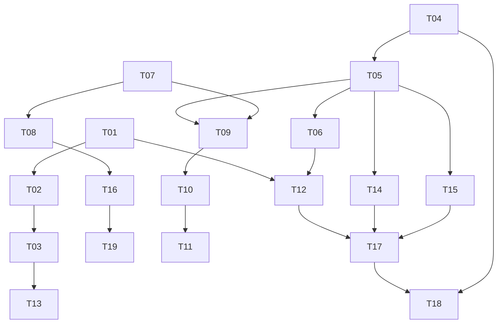

# 任务分解（WBS）与依赖图

> 适用仓库：fork `bslnssb/stashOpenMediaPlayerRemote`（version 1.0.3）｜核实日期：2026-11-10｜状态：公开发布
> 本文档是**派生视图**；任务状态以 `index.yml`、校验脚本与发布门禁的实际结果为准，文档不参与判定。
> 相关文档：[根因复盘](POSTMORTEM.md) · [架构设计](ARCHITECTURE.md) · [复现证据](EVIDENCE.md) · [多语言说明](i18n.md)

> 本地路径说明：文中出现的 `scripts/`、`github-prepare/`、`config.yml` 等均属本地私有工作区的临时路径，只用于还原当时的排查与打包过程，公开仓库并不包含这些文件、也不存在缺件，请勿据此查找；发布物的权威依据是仓库根目录的 `index.yml` 与完整性自检结果，本文及同批文档仅为派生视图。
>
> Note on local paths: mentions of `scripts/`, `github-prepare/`, `config.yml` and similar refer to a private local workspace used only to document the original investigation and packaging steps; they are not part of this public repository and are not missing files, so do not look for them here. The authoritative release artifacts are `index.yml` at the repository root and the integrity self-check; all docs in this batch are derived views.

## 1. 任务分解 WBS

| 编号 | 任务 | 所属模块 | 依赖 | 负责角色 | 交付物（相对路径） | 验收标准 | 状态 |
| --- | --- | --- | --- | --- | --- | --- | --- |
| T01 | 固化 stdin UTF-8 输入适配层与 14 组 locale 矩阵 | 运行时 / 验证 | — | 工程师、QA | `docs/reproduce_locales.py`、私有 locale 脚本、`patches/` | 旧写法 13/14 失败、新写法 14/14 通过，干净 clone 一条命令复现 | 已落地·待固化 |
| T02 | 固化 GraphQL 取路径 + XPath 兜底、`.scene-toolbar` + MutationObserver | 运行时 | T01 | 工程师 | `src/` 前端 js、`src/` client py | 隐藏「文件信息」标签仍可打开；连切 10 场景按钮仅 1 个 | 已落地 |
| T03 | 固化全链路错误上报契约（可见错误 + 退出码 + 结构化日志） | 运行时 / 可观测 | T01 T02 | 工程师、QA | `src/` 主后端 py、log py、前端 js | 注入 exit 1 / GraphQL 失败 / 路径不存在，页面均显示具体原因 | 已落地（不含 R11） |
| T04 | 固化 fork 插件源与 version 1.0.3，不改插件 ID | 分发 | — | 发布者 | `index.yml`、`NOTICE.md` | 干净环境「更新 / 重装」后 T05 全通过 | 已落地 |
| T05 | 固化完整性校验（8 文件 + 5 标记 + 源 URL + sha256） | 门禁 | T04 | 工程师 | 私有完整性校验脚本 | 换回上游 v1.0.2 任一文件或改回上游 URL，非零退出并列出差异 | 已落地 |
| T06 | 固化可复现构建（固定 mtime）+ 脱敏扫描前置拒绝 | 构建 / 门禁 | T05 | 工程师、发布者 | 本地 `prepare.py`、本地发布镜像 | 两次 `prepare.py` 产出 sha256 相同；扫描 0 命中；植入反例被检出 | 已落地 |
| T07 | 固化证据链与勘误表，两条误判显式标「已推翻」 | 文档 / 治理 | — | 产品经理、架构师 | `docs/EVIDENCE.md`、`docs/POSTMORTEM.md` | 误判带作废标记与时间戳，链到可机读证据 | 已落地·本次发布 |
| T08 | 固化 13 语言文档与上游 issue #1 协同材料 | 治理 / i18n | T07 | 产品经理、上游维护者 | `docs/i18n.md`、`docs/i18n/*.md`、`NOTICE.md` | 上游 issue 含英文正文、13 语言折叠摘要、13/14 矩阵；不新增项目级 LICENSE | 已落地 |
| T09 | 编写并发布架构设计文档（三条链路 + 契约 + 模块地图） | 文档 / 架构 | T01–T08 | 架构师 | `docs/ARCHITECTURE.md` | 三张 Mermaid 图在 GitHub 可渲染；契约与真相源表齐备 | 本次发布 |
| T10 | 编写并发布 WBS 与依赖图 | 文档 / 计划 | T09 | 架构师 | `docs/TASKS.md` | ≥14 条、八列齐备、状态与门禁一致 | 本次发布 |
| T11 | 两份 README 加文档索引、机制优先声明与插件源 URL | 文档 / 入口 | T07 T09 T10 | 发布者 | `README.md`、`README.zh-CN.md` | 索引覆盖 5 个 docs 路径；含「文档为派生视图」声明 | 本次发布 |
| T12 | R09 真实链路端到端回归纳入发布门禁 | 门禁 / P1 | T01 T05 T06 | QA、工程师 | 私有回归脚本、`prepare.py` 钩子 | 覆盖「Stash 实发 stdin 字节 → 插件进程 → 播放器调用」+ ≥14 locale + 非 ASCII 路径；禁止手工 JSON / 直接 Popen 充当验收；不一致拒绝发布 | 部分·待办 |
| T13 | R11 缓存失效与生效版本可见性 | 运行时 / P1 | T03 | 工程师、最终用户 | `src/` 前端 js、`src/` 插件定义 yml | JS 带版本化参数；「关于」可见 version 与来源 URL；不再依赖 Ctrl+F5 | 待办 |
| T14 | R12 更新流程原子性与残留态自检 | 生命周期 / P1 | T04 T05 | 工程师、QA | `src/` install py、私有完整性校验脚本 | 模拟卸载失败后自动补齐或显式回滚报错，manifest / log / install 不缺失，不产生半装态 | 待办 |
| T15 | R13 零绝对路径 + 迁移后自检 | 配置 / P1 | T05 | 工程师、发布者 | `config.yml`（本机）、私有自检、本地 `prepare.py` | 全仓盘符 / 绝对路径 0 命中；迁移后 backup_directory_path / metadata 校验通过 | 部分·待办 |
| T16 | R16 上游无维护 / 无 LICENSE 分发策略决策记录 | 治理 / P2 | T08 | 产品经理、架构师、上游维护者 | `docs/GOVERNANCE.md` | 写明触发条件与备选方案（补丁分发 / 独立实现 / 停止分发）及授权裁定人 | 待办 |
| T17 | 门禁总装：G1–G5 全 PASS 才允许产出 | 门禁 | T09–T15 | QA、发布者 | 本地 `prepare.py`、私有校验脚本 | 任一 FAIL 即拒绝产出并列出差异；一条命令可跑 | 待办 |
| T18 | 干净环境「更新 / 重装」验收与用户可见性回归 | 验收 | T04 T05 T12 T14 | QA、最终用户 | `docs/EVIDENCE.md` 追加验收记录 | 中文 Windows + 非 ASCII 路径点击成功或显示明确 errorkind；定位不再依赖抓 stdin 原始字节 | 待办 |
| T19 | 上游 v1.0.3+ 版本号避让与降级判定规则 | 治理 / P2 | T04 T16 | 架构师、上游维护者 | `index.yml`、`docs/GOVERNANCE.md` | 版本号不与上游冲突且不被 Stash 判为降级；规则书面化并经 QA 探测 | 待办 |

## 2. 依赖图与实现顺序

**实现顺序**：① 先回归固化已落地机制（T01–T08），确认 G2/G5 仍 PASS；② 并行推进「文档发布线」T07→T09→T10→T11 与「P1 工程线」T12/T13/T14/T15；③ 总装 T17 后做干净环境验收 T18；④ 治理线 T16/T19 独立并行，不阻塞发布。**关键路径**为 `T01 → T03 → T12 → T17 → T18`：它决定「机制而非提醒」是否真正闭环，也是唯一不能靠文档补上的一段。**可并行项**：三份文档与 README 索引（本次发布最小集 = T07 + T09 + T10 + T11）、13 语言与上游协同材料、治理决策，均不依赖工程线完成。

## 3. 发布验收清单

1. 四张 Mermaid 图（本文件 1 张 + `ARCHITECTURE.md` 3 张）在 GitHub Web 均可渲染，节点文字为简短英文、无特殊字符。
2. 发布前 G1–G5 全 PASS；注入反例（上游 v1.0.2 文件、上游 URL、密钥特征串、mtime 变动）均被拒绝并列出差异。
3. 连续两次 `prepare.py` 的 zip sha256 相同且与 `index.yml` 一致。
4. 干净 clone 下 `docs/reproduce_locales.py` 复现 13/14 与 14/14。
5. 干净环境「更新 / 重装」后完整性自检通过，中文 Windows + 非 ASCII 路径点击成功或页面显示明确 errorkind。
6. 全仓盘符 / 绝对路径 0 命中，`docs/` 脱敏扫描 0 命中。
7. 两份 README 索引链接全部可达且含「文档为派生视图」声明；插件源 URL 全仓指向 fork。
8. **判定原则复核**：临时移走 `docs/` 后，G1–G5 仍能独立拒绝不一致产物——证明这是机制，不是提醒。

---

相关文档：[根因复盘](POSTMORTEM.md) · [架构设计](ARCHITECTURE.md) · [复现证据](EVIDENCE.md) · [多语言说明](i18n.md)
